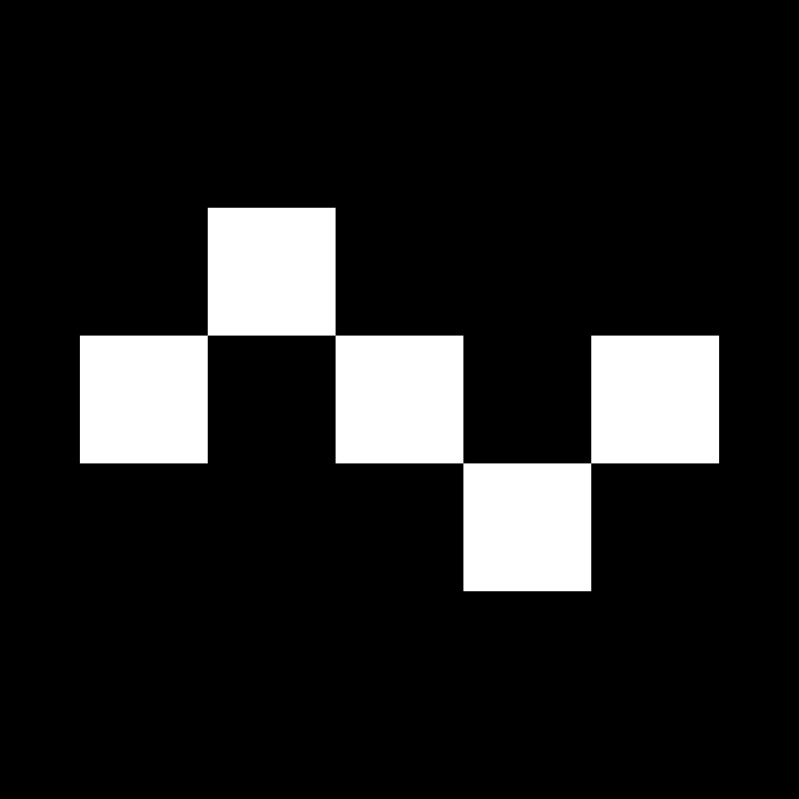
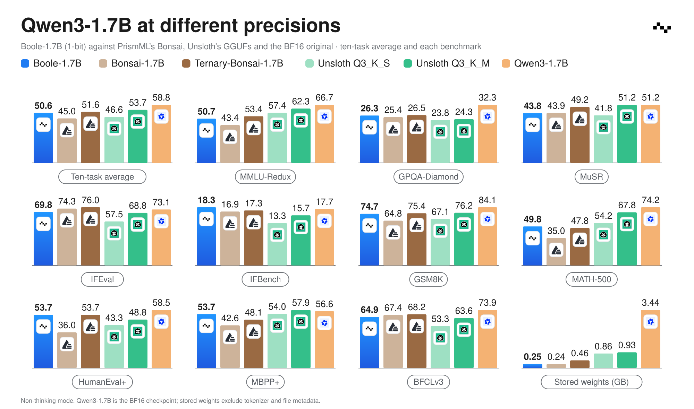

<p align="center">
  
</p>

<h1 align="center">Boole Demo</h1>

<p align="center">
  <strong>Run Boole-1.7B, a 1-bit Qwen3-1.7B, on your own machine.</strong><br>
  llama.cpp for CPU or CUDA, vLLM + Humming for a CUDA GPU.
</p>

<p align="center">
  <a href="https://huggingface.co/precision-numerics/Boole-1.7B">🤗 Model</a>
  &nbsp;·&nbsp;
  <a href="https://precisionnumerics.ai/chat/">💬 On-Device Chat</a>
  &nbsp;·&nbsp;
  <a href="https://precisionnumerics.ai/blog/boole-1p7b">Blog</a>
  &nbsp;·&nbsp;
  <a href="#quick-start">Quick start</a>
</p>



Boole-1.7B is a 1-bit language model derived from Qwen3-1.7B. Its weights take 247 MB,
13.9× less than the BF16 original, and it keeps 85.9% of the original's ten-task benchmark
average. See the [blog](https://precisionnumerics.ai/blog/boole-1p7b) for the evaluation.

| Runtime | Model file | Hardware |
| --- | --- | --- |
| [llama.cpp](#llamacpp) | `Boole-1.7B-Q1_0.gguf` (292.1 MB) | CPU or CUDA GPU |
| [vLLM + Humming](#vllm--humming) | `Boole-1.7B.safetensors` (247.1 MB), exported locally | CUDA GPU, bf16, single GPU |

The GGUF is larger because it stores the embedding and output matrices separately; the
safetensors file shares their sign bits and keeps separate scales.

## Quick start

Python 3.10 or newer is required. Run the commands from a clone of this repository:

```bash
git clone https://github.com/PrecisionNumerics/boole-demo.git
cd boole-demo

python -m venv .venv
source .venv/bin/activate
python -m pip install huggingface_hub

export MODEL_REPO=precision-numerics/Boole-1.7B
```

The examples use a 4,096-token context and disable thinking, which is the supported mode.

### llama.cpp

Download the GGUF, then fetch and build the pinned llama.cpp release:

```bash
hf download "$MODEL_REPO" --include '*-Q1_0.gguf' --local-dir model
bash scripts/setup_llama_cpp.sh            # CUDA build; GGML_CUDA=0 for CPU only
```

Start the server and open the URL it prints:

```bash
third_party/llama.cpp/build/bin/llama-server \
    -m model/*-Q1_0.gguf \
    -ngl 99 -c 4096 \
    --chat-template-kwargs '{"enable_thinking": false}'
```

Use `-ngl 0` on CPU. Try: **Explain why the sky is blue in one sentence.**

### vLLM + Humming

Install the loader, export the model, and start the server:

```bash
python -m pip install -e '.[vllm]'
boole-prep vllm "$MODEL_REPO" --out out/humming

vllm serve out/humming \
    --dtype bfloat16 --max-model-len 4096 \
    --default-chat-template-kwargs '{"enable_thinking": false}'
```

In another terminal, send a chat request (replace `<server-url>` with the server's URL):

```bash
curl -sS '<server-url>/v1/chat/completions' \
    -H 'Content-Type: application/json' \
    -d '{
      "model": "out/humming",
      "messages": [{"role": "user", "content": "Explain why the sky is blue in one sentence."}],
      "max_tokens": 128,
      "temperature": 0
    }'
```

The reply is in `choices[0].message.content`.

`boole-prep` downloads the packed checkpoint and writes a vLLM model directory. Installing
the package registers a vLLM plugin that loads the 1-bit embedding and output head. The model
repository includes the Qwen3-1.7B config and tokenizer files, so a downloaded model directory
can also be exported offline by passing its path instead of `MODEL_REPO`.

The loader targets **vLLM 0.31.0** and **humming-kernels 0.1.16**, both pinned by the `vllm` extra.

## Repository layout

| Path | Contents |
| --- | --- |
| `src/boole_demo/` | Checkpoint reader, vLLM export, vLLM plugin and the `boole-prep` command |
| `scripts/` | `setup_llama_cpp.sh`: fetch and build the pinned llama.cpp |
| `tests/` | CPU-only tests on a synthetic checkpoint (`pip install -e '.[dev]'`, then `pytest`) |
| `assets/` | README figure and logo |

## License

Runtime code and model weights are licensed under **Apache License 2.0**. See the
[runtime license](LICENSE) and the
[model license](https://huggingface.co/precision-numerics/Boole-1.7B/blob/main/LICENSE).
